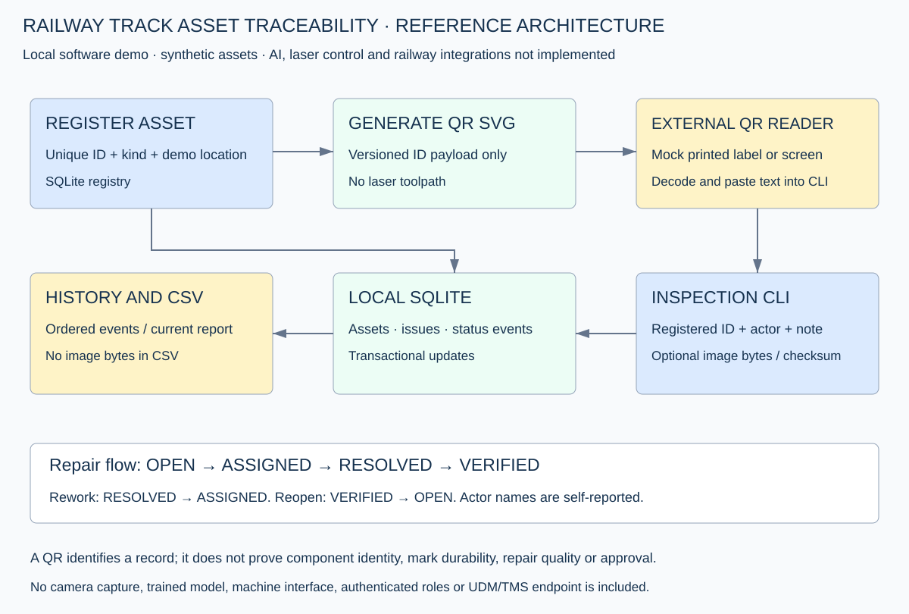
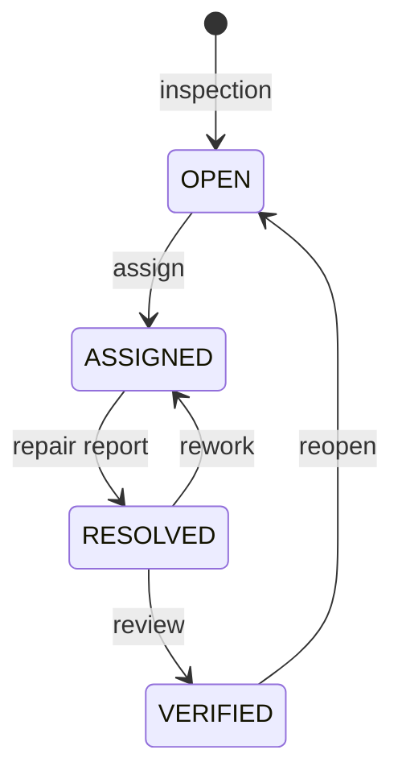

# Architecture and schema

The diagram above describes the original CLI. The authenticated portal adds a browser → Flask routes → the same SQLite records, with web extension tables for accounts, sessions, assignments and authenticated action history. See [web application design](web-app.md).

The custom QR payload is `RAILASSET:1:<ASSET_ID>`. Only the ID is encoded; location, photographs and notes remain in SQLite. The code accepts either a valid raw ID or an exact supported prefix. Malformed/unsupported payload versions fail validation; unregistered IDs cannot generate labels or inspection records. A copied QR can still point to the same record; no physical anti-cloning or signed identity binding exists.

## Tables

| Table | Purpose |
|---|---|
| assets | Unique ID, component kind, text location and creation timestamp |
| issues | Issue ID, asset foreign key, current status, original note/actor/time, optional photo bytes/hash |
| events | Sequence number, issue foreign key, previous/new status, actor/note/time |

Parameterized SQL is used for values and foreign keys are enabled. An inspection and its initial OPEN event commit together. Transitions use a write transaction (`BEGIN IMMEDIATE`) so current-state checks, updates and events are serialized for local database processes. Errors roll back the transaction. Core database schema version remains 1. The explicit `init-web` command adds a separately versioned web extension without rewriting core records; future schema migrations are not provided.

The database and history are ordinary editable local files, not an immutable or cryptographically signed audit. CLI actors are unverified strings. Web routes use authenticated account identities and enforce assignment/reviewer rules, but database/CLI access remains trusted and can bypass these rules. A state transition is still not proof that a physical repair occurred or was correct. Image hashes provide byte identity, not an authenticity claim. No downstream AI decision or live railway control occurs.

CSV exports report the current issue metadata and hash only. Image evidence remains in SQLite. The portal serves authenticated normalized web uploads; legacy CLI image bytes are not served. It has no original-image archive/export UI. Text cells beginning with common spreadsheet formula prefixes are prefixed with an apostrophe. Web role authorization is implemented as described in web-app.md. File permissions, encryption, retention and external synchronization still need separate deployment work.
