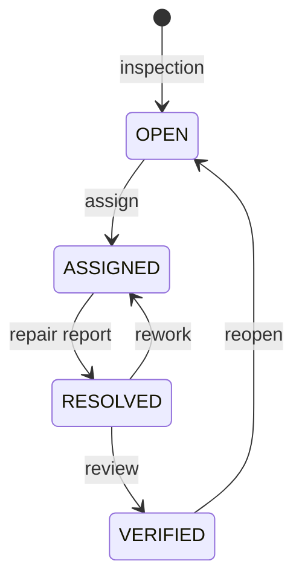

# Architecture and schema

The custom QR payload is `RAILASSET:1:<ASSET_ID>`. Only the ID is encoded; location, photographs and notes remain in SQLite. The code accepts either a valid raw ID or an exact supported prefix. Malformed/unsupported payload versions fail validation; unregistered IDs cannot generate labels or inspection records. A copied QR can still point to the same record; no physical anti-cloning or signed identity binding exists.

## Tables

| Table | Purpose |
|---|---|
| assets | Unique ID, component kind, text location and creation timestamp |
| issues | Issue ID, asset foreign key, current status, original note/actor/time, optional photo bytes/hash |
| events | Sequence number, issue foreign key, previous/new status, actor/note/time |

Parameterized SQL is used for values and foreign keys are enabled. An inspection and its initial OPEN event commit together. Transitions use a write transaction (`BEGIN IMMEDIATE`) so current-state checks, updates and events are serialized for local database processes. Errors roll back the transaction. Database schema version is 1; upgrades/migrations are not provided.

The database and history are ordinary editable local files, not an immutable or cryptographically signed audit. Actors are unverified strings; a state transition does not prove a worker was assigned, a repair occurred or an independent verifier approved it. Image hashes provide byte identity, not an authenticity claim. No downstream AI decision or live railway control occurs.

CSV exports report the current issue metadata and hash only. Image evidence remains in SQLite; there is no image-export UI. Text cells beginning with common spreadsheet formula prefixes are prefixed with an apostrophe. File permissions, encryption, user authorization, retention and external synchronization are outside the current demo.
